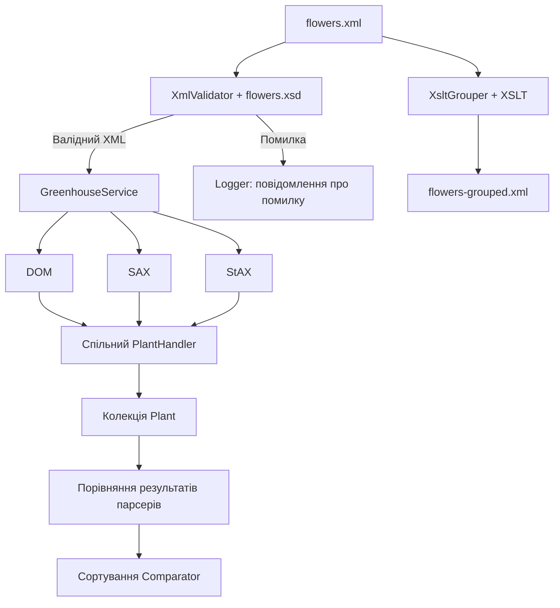

# Лабораторна робота №2 з об'єктно-орієнтованого програмування

**Варіант 1 — «Оранжерея»**  
**Тема:** XML, XSD, DOM, SAX, StAX, XSLT, Comparator, Unit-тестування та логування в Java.

## 1. Мета та завдання

**Мета роботи** — навчитися створювати та перевіряти XML-документи за допомогою XSD, обробляти XML засобами Java, застосовувати принципи ООП, сортувати колекції, виконувати XSLT-перетворення, писати Unit-тести та організовувати проєкт із Git і логуванням.

Згідно з **варіантом 1**, потрібно описати рослини оранжереї. Кожна рослина має назву, тип ґрунту, місце походження, зовнішні параметри (колір стебла, колір листя, середній розмір), умови вирощування (температура, світлолюбність, полив) та спосіб розмноження. Кореневий елемент XML називається **`Flower`**.

Програма:

1. Перевіряє вхідний XML за XSD-схемою.
2. Зчитує його **трьома незалежними способами**: DOM, SAX та StAX.
3. Перетворює дані на колекцію Java-об'єктів `Plant`.
4. Перевіряє, що три парсери повернули однакові результати.
5. Сортує рослини через `Comparator` за назвою та середнім розміром.
6. Застосовує XSLT, щоб згрупувати рослини за типом ґрунту.
7. Записує повідомлення про роботу програми через `Logger`.

## 2. Технології

| Технологія | Призначення |
|---|---|
| **Java 17** | Модель даних, парсери та логіка застосунку |
| **Maven** | Збирання проєкту, залежності та запуск тестів |
| **XML** | Початкові дані про рослини |
| **XSD** | Опис структури XML та перевірка обмежень |
| **DOM, SAX, StAX** | Три способи розбору XML |
| **XSLT 1.0** | Перетворення XML і групування рослин |
| **JUnit 5** | Автоматизовані модульні тести |
| **JaCoCo** | Звіт про покриття коду тестами |
| **java.util.logging** | Повідомлення в консоль і файл |
| **Git / GitHub** | Історія змін і віддалений репозиторій |

DOM, SAX, StAX, XSD-валідація та XSLT реалізовані стандартними засобами JDK. JUnit 5 і JaCoCo налаштовані у `pom.xml`.

## 3. Структура проєкту

```text
Greenhouse_OOP_Lab2/
├── .editorconfig
├── .gitignore
├── pom.xml
├── README.md
├── examples/
│   └── flowers-grouped.xml         # Приклад XML після XSLT
├── scripts/
│   ├── run-linux.sh
│   └── run-windows.ps1             # Запуск без Maven на Windows
└── src/
    ├── main/
    │   ├── java/ua/edu/oop/greenhouse/
    │   │   ├── Main.java          # Точка входу
    │   │   ├── model/
    │   │   │   ├── Plant.java
    │   │   │   ├── Soil.java
    │   │   │   ├── Multiplying.java
    │   │   │   ├── VisualParameters.java
    │   │   │   ├── GrowingTips.java
    │   │   │   └── PlantComparators.java
    │   │   ├── parser/
    │   │   │   ├── PlantParser.java
    │   │   │   ├── PlantHandler.java
    │   │   │   ├── DomPlantParser.java
    │   │   │   ├── SaxPlantParser.java
    │   │   │   ├── StaxPlantParser.java
    │   │   │   └── XmlProcessingException.java
    │   │   ├── service/
    │   │   │   ├── GreenhouseService.java
    │   │   │   ├── XmlValidator.java
    │   │   │   └── XsltGrouper.java
    │   │   └── util/
    │   │       ├── LogConfig.java
    │   │       └── XmlSecurity.java
    │   └── resources/
    │       ├── flowers.xml
    │       ├── flowers.xsd
    │       ├── group-by-soil.xsl
    │       └── logging.properties
    └── test/java/ua/edu/oop/greenhouse/
        ├── ModelTest.java
        ├── ParserTest.java
        ├── ServiceAndMainTest.java
        ├── TransformationTest.java
        ├── ValidationTest.java
        ├── TestFiles.java
        └── parser/
            └── PlantHandlerTest.java
```

> Папка **`target/`** може з'явитися після запуску або збирання. Вона містить автоматично згенеровані файли та виключена з Git через `.gitignore`. 

## 4. Модель даних XML та XSD

### XML-документ

Файл `src/main/resources/flowers.xml` містить **6 рослин**. `<Flower>` є кореневим елементом-контейнером, а кожен `<Plant>` представляє одну рослину.

Приклад фрагмента з файлу:

```xml
<Plant id="ficus_01">
    <Name>Ficus</Name>
    <Soil>ground</Soil>
    <Origin>Southeast Asia</Origin>
    <VisualParameters>
        <StemColor>brown</StemColor>
        <LeafColor>dark green</LeafColor>
        <AverageSizeCm unit="cm">120.5</AverageSizeCm>
    </VisualParameters>
    <GrowingTips>
        <TemperatureCelsius>22</TemperatureCelsius>
        <LightLoving>false</LightLoving>
        <WateringMlPerWeek>600</WateringMlPerWeek>
    </GrowingTips>
    <Multiplying>cuttings</Multiplying>
</Plant>
```

**Характеристики рослини:**

| Поле XML | Значення |
|---|---|
| `Plant/@id` | Унікальний ідентифікатор рослини |
| `Name` | Назва рослини |
| `Soil` | Тип ґрунту |
| `Origin` | Походження |
| `VisualParameters` | Колір стебла, колір листя, середній розмір у сантиметрах |
| `GrowingTips` | Температура, світлолюбність, полив у мл/тиждень |
| `Multiplying` | Спосіб розмноження |

### XSD-схема

Файл `src/main/resources/flowers.xsd` задає структуру й типи XML-даних:

- **Прості типи:** `SoilType`, `MultiplyingType`, `SizeType`, `TemperatureType`, `WateringType`.
- **Комплексні типи:** `PlantType`, `VisualParametersType`, `GrowingTipsType`, `SizeWithUnitType`.
- **Переліки (`xs:enumeration`):** ґрунт — `podzolic`, `ground`, `sod-podzolic`; розмноження — `leaves`, `cuttings`, `seeds`.
- **Граничні значення:** середній розмір **0.1–500 см**, температура **−30…60 °C**, полив **0–10000 мл/тиждень**.
- **Обов'язкові атрибути:** `Plant/@id` має тип **`xs:ID`** (унікальний у документі); `AverageSizeCm/@unit` є обов'язковим і має фіксоване значення **`cm`**.
- **Кількість елементів:** корінь `<Flower>` містить щонайменше одну рослину; `Plant` має `maxOccurs="unbounded"`.

**Приклад:** якщо змінити `<Soil>ground</Soil>` на `<Soil>sand</Soil>`, XSD-валідація відхилить XML, оскільки `sand` не входить до дозволеного переліку. Так само помилкою буде дубльований `id` або відсутній обов'язковий атрибут `unit`.

## 5. Архітектура та принцип роботи



### Об'єктна модель

- `Plant` — одна рослина: ідентифікатор, назва, ґрунт, походження, зовнішні параметри, умови вирощування та розмноження.
- `VisualParameters` — колір стебла, колір листя, середній розмір.
- `GrowingTips` — температура, світлолюбність, обсяг поливу.
- `Soil` і `Multiplying` — переліки (`enum`), що обмежують допустимі значення.
- `PlantComparators` — два об'єкти `Comparator<Plant>` для різних способів сортування.

Для моделі використано **Java records**, що зберігають дані в незмінюваному вигляді та автоматично отримують `equals`, `hashCode` і `toString`. Конструктори моделі додатково перевіряють значення полів.

### Три XML-парсери

Усі реалізують інтерфейс `PlantParser` із методом `parse(Path)`, який повертає `List<Plant>`:

- **DOM (`DomPlantParser`)** читає документ у дерево вузлів, потім обходить елементи `<Plant>`.
- **SAX (`SaxPlantParser`)** послідовно читає XML і реагує на події `startElement`, `characters`, `endElement`.
- **StAX (`StaxPlantParser`)** послідовно читає XML за принципом *pull*: код сам запитує наступну подію.

### Один спільний `PlantHandler`

Усім трьом парсерам потрібна однакова логіка формування об'єктів рослин. Тому замість трьох окремих реалізацій перетворення текстових полів використовується **єдиний клас `PlantHandler`**:

```java
handler.startPlant(id);
handler.acceptField(elementName, value);
handler.endPlant();
```

Метод `getPlants()` повертає сформовану колекцію. DOM і StAX викликають спільний обробник безпосередньо. SAX додатково має **технічний** `SaxEventAdapter extends DefaultHandler`: це адаптер для подій SAX, а **не другий обробник бізнес-логіки**; він передає дані тому самому `PlantHandler`.

**Принципи ООП:** інкапсуляція в моделях, інтерфейс `PlantParser` та поліморфізм його трьох реалізацій, поділ відповідальностей між `model`, `parser`, `service`, `util` і повторне використання спільної логіки без дублювання.

## 6. Сортування, валідація, XSLT та логування

### Сортування через `Comparator`

У `PlantComparators.java` визначені:

- `BY_NAME` — за назвою без урахування регістру, за однакових назв — за `id`;
- `BY_AVERAGE_SIZE` — за середнім розміром за зростанням, за однакових розмірів — за `id`.

Приклад використання:

```java
plants.stream().sorted(PlantComparators.BY_NAME);
plants.stream().sorted(PlantComparators.BY_AVERAGE_SIZE);
```

### Валідація

`XmlValidator` перевіряє документ за `flowers.xsd` **до** запуску парсерів. Якщо дані не відповідають схемі, програма повідомляє про помилку і не продовжує обробку. `XmlSecurity` налаштовує XML-обробники з обмеженнями на небезпечні зовнішні сутності та DTD.

### XSLT-перетворення

`group-by-soil.xsl` використовує **XSLT 1.0**, `xsl:key` та групування за значенням `Soil`. Початковий суцільний список рослин перетворюється на групи:

```xml
<FlowerGroupedBySoil>
    <SoilGroup soil="ground">
        <!-- Рослини з ґрунтом ground -->
    </SoilGroup>
    <SoilGroup soil="podzolic">
        <!-- Рослини з ґрунтом podzolic -->
    </SoilGroup>
    <SoilGroup soil="sod-podzolic">
        <!-- Рослини з ґрунтом sod-podzolic -->
    </SoilGroup>
</FlowerGroupedBySoil>
```

Це **скорочений приклад**; справжні вузли `<Plant>` з усіма полями знаходяться у `examples/flowers-grouped.xml`. Під час запуску програма створює `target/flowers-grouped.xml`. У наборі прикладів утворюються **3 групи по 2 рослини**. Одержаний XML має нову структуру й не зобов'язаний відповідати початковій XSD-схемі.

### Логування

Замість звичайного виведення всіх повідомлень через `System.out.println` використано **`java.util.logging.Logger`**. Файл `logging.properties` задає рівні та формат повідомлень. Події роботи програми виводяться в консоль і записуються в `target/greenhouse-0.log` (або файл з іншим індексом), зокрема:

- результат XSD-валідації;
- кількість об'єктів, яку отримав кожен із трьох парсерів;
- відсортовані рослини;
- шлях до результату XSLT;
- повідомлення про помилки на рівні `SEVERE`.

## 7. Запуск у VS Code на Windows

### 7.1. Підготовка

1. Встановити **JDK 17 або новішу**, **Maven**, **Git** і **VS Code**.
2. У VS Code бажано встановити розширення **Extension Pack for Java** (за потреби — **Maven for Java**).
3. Відкрити **File → Open Folder** і вибрати папку `Greenhouse_OOP_Lab2`, яка містить `pom.xml`.
4. Відкрити **Terminal → New Terminal**. У Windows зручно використовувати PowerShell.

Перевірити інструменти:

```powershell
java -version
javac -version
mvn -version
git --version
dir pom.xml
```

Якщо `dir pom.xml` не знаходить файл, термінал відкрито не в корені проєкту.

### 7.2. Збирання, тести й запуск

```powershell
mvn clean verify
java -jar target/greenhouse-xml-lab2-1.0.0.jar
```

`mvn clean verify` компілює код, запускає JUnit-тести, створює JAR і звіт JaCoCo. Успішне завершення Maven показує **`BUILD SUCCESS`**. Після запуску застосунку перевірити:

```text
target/flowers-grouped.xml
target/surefire-reports/
target/site/jacoco/index.html
target/greenhouse-*.log
```

> **Важливо:** запускати `java -jar ...` потрібно з кореня проєкту, бо програма використовує відносні шляхи `src/main/resources/...`.

### 7.3. Запуск без Maven (лише основна програма)

За наявності JDK 17, але без налаштованого Maven, у PowerShell можна виконати:

```powershell
powershell -ExecutionPolicy Bypass -File scripts/run-windows.ps1
```

Цей скрипт компілює Java-код та запускає програму, **але не запускає JUnit-тести й не створює звіт JaCoCo**. Для повної перевірки потрібна команда `mvn clean verify`.

### 7.4. Запуск із власними файлами

Програма може приймати рівно **4 аргументи**: `XML`, `XSD`, `XSL`, шлях вихідного XML.

```powershell
java -jar target/greenhouse-xml-lab2-1.0.0.jar src/main/resources/flowers.xml src/main/resources/flowers.xsd src/main/resources/group-by-soil.xsl target/custom-output.xml
```

## 8. Unit-тести й покриття

Тести розміщені у `src/test/java/ua/edu/oop/greenhouse/`.

| Файл | Що перевіряє |
|---|---|
| `ModelTest.java` | Створення об'єктів, перевірку значень, сортування |
| `ParserTest.java` | Роботу DOM, SAX, StAX та узгодженість результатів |
| `parser/PlantHandlerTest.java` | Спільний `PlantHandler` і некоректні стани |
| `ValidationTest.java` | Валідний XML і помилки XSD: перелік, межі, атрибути, ID |
| `TransformationTest.java` | Групування за ґрунтом, повноту результату |
| `ServiceAndMainTest.java` | Взаємодію компонентів, запуск та обробку помилок |
| `TestFiles.java` | Допоміжні тестові файли та шляхи |

Команди:

```powershell
mvn test          # Запуск JUnit-тестів
mvn clean verify  # Повна збірка, тести та звіт про покриття
```

Перегляд результатів:

- `target/surefire-reports/` — результати JUnit;
- `target/site/jacoco/index.html` — HTML-звіт JaCoCo (відкрити в браузері).


## 9. Відповідність умовам лабораторної

| Вимога з умови | Реалізація |
|---|---|
| XML та XSD | `flowers.xml`, `flowers.xsd` |
| Прості, комплексні типи, переліки, межі, обов'язкові атрибути, `ID` | Типи та обмеження у `flowers.xsd` |
| Java-класи за XML | `model/Plant.java`, `VisualParameters.java`, `GrowingTips.java`, `enum` |
| DOM, SAX, StAX | `parser/DomPlantParser.java`, `SaxPlantParser.java`, `StaxPlantParser.java` |
| Колекція об'єктів | `List<Plant>` із `parse(Path)` |
| Відсутність дублювання | `PlantParser`, спільний `PlantHandler`, поділ на пакети |
| `Comparator` | `model/PlantComparators.java` |
| Валідація XML через XSD | `service/XmlValidator.java` |
| XSLT зі зміненою структурою та групуванням | `group-by-soil.xsl`, `service/XsltGrouper.java` |
| Unit-тести | `src/test/java/` (JUnit 5), JaCoCo |
| Правильно налаштований Logger | `util/LogConfig.java`, `logging.properties` |


## 10. Висновок 

У лабораторній роботі реалізовано Java-застосунок для обробки XML-даних про рослини оранжереї. Створено XML-документ та XSD-схему, об'єктну модель, три парсери зі спільною логікою, валідацію, сортування через `Comparator`, XSLT-групування, автоматизовані тести й логування. Структура проєкту відокремлює моделі, парсери, сервіси та допоміжні компоненти, що спрощує розширення й тестування.

